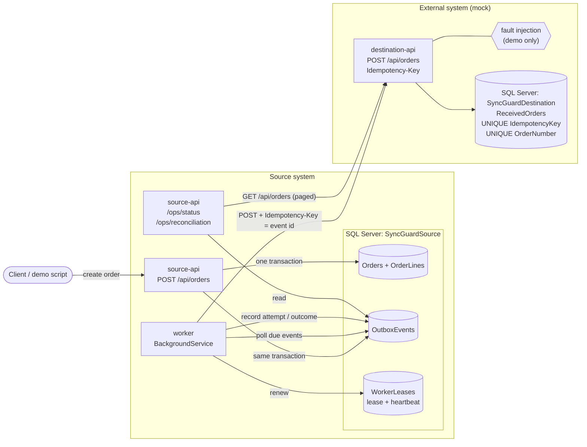
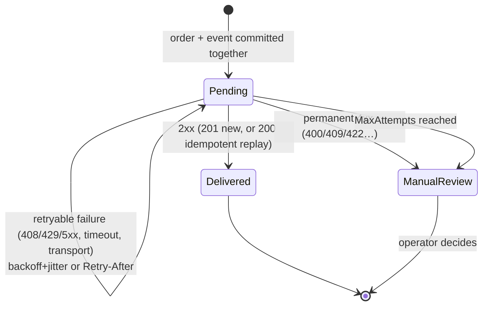

# SyncGuard — Reliable SQL Server → REST Synchronization

A small, production-minded demonstration of keeping a SQL Server application and an unreliable external REST API
consistent: **transactional outbox → durable retrying worker → idempotent destination → reconciliation**.

> Portfolio demonstration with synthetic data. It is not a product, a SaaS platform, or a customer deployment.

**Delivery guarantee: at-least-once delivery with durable idempotency.** The system does **not** claim exactly-once
delivery. A request may be sent more than once (for example after a lost response); the destination's unique
idempotency key makes the repeat harmless, so each order is *booked* at most once and, once the system settles, exactly once.

## Requirements

| Tool | Version | Used for |
|---|---|---|
| Docker + Docker Compose v2 | Docker 24+ | Running the demo and the integration tests (SQL Server via Testcontainers) |
| .NET SDK | 10.0 | Building and running tests on the host (optional if you use the container command below) |
| `curl`, optionally `jq` | any | Demo commands |

SQL Server 2022 runs in a container (`mcr.microsoft.com/mssql/server:2022-latest`, x86-64). It needs about 2 GB of RAM.

## Quick start

```bash
cp .env.example .env            # then edit MSSQL_SA_PASSWORD to your own local value
docker compose up -d --build    # sqlserver → db-init (schema) → destination-api, source-api, worker
curl -s localhost:5001/health   # "Healthy" once the worker has started (≈10–30 s on first run)
```

| Service | URL | Role |
|---|---|---|
| source-api | http://localhost:5001 | Creates orders and outbox events; ops and reconciliation endpoints |
| destination-api | http://localhost:5002 | Mock fulfilment API with idempotency and (opt-in) fault injection |
| worker | (no HTTP) | Delivers outbox events to the destination |
| sqlserver | localhost:14333 | Two databases: `SyncGuardSource`, `SyncGuardDestination` |

Create an order and watch it synchronize:

```bash
curl -s -X POST localhost:5001/api/orders -H 'content-type: application/json' \
  -d '{"orderNumber":"DEMO-1","customerCode":"CUST-007","lines":[{"sku":"ABC-1234","quantity":3,"unitPrice":12.50}]}'
curl -s localhost:5001/api/orders/DEMO-1        # outbox.status → "Delivered", attemptCount, destinationId
curl -s localhost:5001/ops/status               # counts, retries, last successful sync, worker health
curl -s localhost:5001/ops/reconciliation       # isConsistent / discrepancies
```

Stop with `docker compose down` (keeps data) or `docker compose down -v` (wipes the databases).

## Architecture



### Delivery state machine (per outbox event)



### How each failure is handled

| Failure | What happens |
|---|---|
| HTTP 500 / 503 / 504 | Retryable. Next attempt after capped exponential backoff with jitter: uniform in `[d/2, d]`, `d = min(MaxRetryDelay, BaseRetryDelay·2^(n-1))`. `Retry-After` on a 503 is honoured too. |
| HTTP 429 | Retryable. `Retry-After` (seconds or HTTP-date) is honoured exactly; never retried earlier. |
| Timeout / connection refused / reset | Retryable. The per-request timeout is enforced by the dispatcher. |
| Response lost after the destination committed | The worker sees a transport error and retries with the **same** `Idempotency-Key`. The destination finds the existing row and returns `200` with the original `destinationId`. No duplicate. |
| Duplicate / concurrent requests | `UNIQUE(IdempotencyKey)` in SQL. The losing concurrent insert gets the existing result. The same key with a different payload returns `409`. |
| Invalid data (destination says 400/409/422) | Permanent. Moved to `ManualReview` after one attempt and never retried automatically. |
| Retries exhausted (`MaxAttempts`, default 8) | `ManualReview` with the last error. |
| Worker crash or restart | All state is in SQL. The attempt is recorded *before* sending, so a crash mid-request still counts toward `MaxAttempts`, and the event becomes due again after its backoff. A graceful stop releases the lease (instant resume); a crash means the next worker waits for the lease to expire (`LeaseDuration`, 30 s). |
| Destination down for a long time | Events stay `Pending` and back off up to `MaxRetryDelay`, then go to `ManualReview` after `MaxAttempts`. |

### Reconciliation and the settle-window rule

`GET /ops/reconciliation[?settleSeconds=N]` reads the source first, then pages through the destination's
`GET /api/orders`, and classifies every order:

| Kind | Meaning |
|---|---|
| Matched | Present at the destination with the same customer, total and lines |
| InFlight | `Pending` and created within the settle window (default 5 min). **Not** a discrepancy. |
| Missing | Source says `Delivered`, destination does not have it (data lost or deleted downstream) |
| Mismatched | Present but differs (fields listed) |
| Undelivered | `ManualReview`, or still `Pending` beyond the settle window |
| Unexpected | At the destination but not in the source (re-checked to rule out orders created mid-run) |
| Duplicated | More than one destination record for one order number (the unique key should prevent this) |

Ordering argument: an event marked `Delivered` was committed at the destination before the worker saw the 2xx. The
source is read first, so "Delivered in the snapshot but absent at the destination" is a real loss, not a race.
`isConsistent` means no discrepancies. `isSettled` means nothing is in flight.

## API summary

| Method & path | Purpose |
|---|---|
| `POST /api/orders` (source) | Create an order. The order, its lines and its outbox event are written in **one transaction**. `409` if the order number exists. |
| `POST /api/orders/seed?count=1000&seed=42` (source) | Deterministic synthetic orders: the same seed gives the same orders, and existing ones are skipped. |
| `GET /api/orders/{orderNumber}` (source) | Order plus delivery state: status, attempts, next attempt, last status/error, destination id. |
| `GET /ops/status` (source) | Worker health, pending/due/failed counts, retry metrics, last successful sync. |
| `GET /ops/reconciliation` (source) | Report described above. |
| `GET /health` (source, destination) | Built-in health checks. The source reports `Degraded` if the worker heartbeat is stale. |
| `POST /api/orders` (destination) | Requires `Idempotency-Key`. `201` new, `200` replay, `409` key or order-number conflict, `422` invalid. |
| `GET /api/orders?afterId=&take=` (destination) | Keyset-paged feed for reconciliation. |
| `GET/POST/DELETE /fault-injection/rules` (destination) | **Demo only.** Only mapped when `FaultInjection__Enabled=true`. |

## Failure-injection demo commands

Fault rules are deterministic: *"apply `fault` to every `everyNth`-th order request, `count` times"*, optionally only for
one `orderNumber`. Targeted rules keep demos readable, because the worker delivers in parallel. Faults are
`Http500`, `Http503`, `Http429` (+`retryAfterSeconds`), `Timeout` (+`delayMs`), and `LostResponse` (commit, then abort the connection).

```bash
F=localhost:5002/fault-injection/rules; J='content-type: application/json'
order() { curl -s -X POST localhost:5001/api/orders -H "$J" -d "{\"orderNumber\":\"$1\",\"customerCode\":\"CUST-007\",\"lines\":[{\"sku\":\"${2:-ABC-1234}\",\"quantity\":1,\"unitPrice\":9.99}]}"; echo; }
show()  { curl -s localhost:5001/api/orders/$1; echo; }

# 503 x3, then recovery (watch attemptCount climb to 4)
curl -s -X POST $F -H "$J" -d '{"fault":"Http503","count":3,"orderNumber":"F-503"}'; order F-503; sleep 1; show F-503; sleep 15; show F-503

# 429 with Retry-After: 10 (nextAttemptAtUtc = lastAttemptAtUtc + 10 s)
curl -s -X POST $F -H "$J" -d '{"fault":"Http429","retryAfterSeconds":10,"orderNumber":"F-429"}'; order F-429; sleep 1; show F-429

# Lost response: destination commits, connection dropped; retry is an idempotent replay (lastStatusCode 200, one row)
curl -s -X POST $F -H "$J" -d '{"fault":"LostResponse","orderNumber":"F-LOST"}'; order F-LOST; sleep 1; show F-LOST; sleep 3; show F-LOST

# Timeout (destination stalls 8 s; worker gives up after 5 s and retries)
curl -s -X POST $F -H "$J" -d '{"fault":"Timeout","delayMs":8000,"orderNumber":"F-SLOW"}'; order F-SLOW; sleep 7; show F-SLOW

# Permanently invalid data → ManualReview after one attempt, never retried
order F-BAD 'bad sku'; sleep 2; show F-BAD

# Destination completely down, then back
docker compose stop destination-api; order F-DOWN; sleep 4; show F-DOWN
docker compose start destination-api; sleep 10; show F-DOWN

# Worker restart (graceful) and crash (SIGKILL) while 1,000 orders flow through a fault mix
for r in '{"fault":"Http503","count":60,"everyNth":7}' '{"fault":"Http429","count":30,"everyNth":11,"retryAfterSeconds":3}' \
         '{"fault":"LostResponse","count":40,"everyNth":13}' '{"fault":"Http500","count":20,"everyNth":17}'; do curl -s -o /dev/null -X POST $F -H "$J" -d "$r"; done
curl -s -X POST "localhost:5001/api/orders/seed?count=1000&seed=2026"; echo
docker compose restart worker; sleep 2; docker compose kill -s SIGKILL worker; docker compose start worker
watch -n2 'curl -s localhost:5001/ops/status'          # pending → 0, retryAttempts > 0
curl -s localhost:5001/ops/reconciliation | jq '{isConsistent, isSettled, counts}'

# Tamper with destination data; reconciliation finds it
docker compose exec -T sqlserver bash -c 'SQLCMDPASSWORD="$MSSQL_SA_PASSWORD" /opt/mssql-tools18/bin/sqlcmd -C -b -S localhost -U sa -d SyncGuardDestination' <<'SQL'
DELETE ReceivedOrders WHERE OrderNumber = 'SEED2026-00001';
UPDATE ReceivedOrders SET TotalAmount = TotalAmount + 1 WHERE OrderNumber = 'SEED2026-00002';
GO
SQL
curl -s localhost:5001/ops/reconciliation | jq '.counts, .discrepancies[:5]'

curl -s -X DELETE $F     # clear remaining fault rules
```

For an interactive SQL prompt use the same `docker compose exec … sqlcmd …` command without `-T` and the heredoc.

## Tests

```bash
dotnet test        # needs Docker running; Testcontainers starts a throwaway SQL Server
```

30 tests: 15 unit test cases (backoff bounds and cap, Retry-After parsing, status classification, deterministic and targeted fault rules,
deterministic seed data) and 15 integration tests against real SQL Server that cover all nine acceptance scenarios plus edge cases:

| Scenario | Test |
|---|---|
| Order + outbox atomicity | `S0_order_and_outbox_event_commit_together_or_not_at_all` |
| 1 Normal sync | `S1_normal_order_synchronizes_successfully` |
| 2 503 recovers; unreachable + timeout | `S2_http_503_…`, `S2b_unreachable_destination_and_timeouts_…` |
| 3 429 Retry-After | `S3_http_429_respects_retry_after` (exact `now + 120 s`, not retried at 119 s) |
| 4 Duplicates | `S4_duplicate_requests_…` (replay, payload conflict, 20 concurrent identical requests), `S4b_worker_redelivery_…` |
| 5 Lost response | `S5_lost_response_after_successful_persistence_…` |
| 6 Worker restart | `S6_restarting_the_worker_…` (real `BackgroundService` stopped mid-flight, new instance finishes 200/200), `S6b_lease_…` (crash takeover) |
| 7 Invalid data isolated | `S7_permanently_invalid_data_…`, `S7b_…max_attempts…`, `S7c_…never_recorded_an_outcome…` |
| 8 Reconciliation | `S8_reconciliation_detects_missing_altered_unexpected_and_undelivered_orders` (incl. the settle-window transition) |
| 9 1,000 orders | `S9_one_thousand_orders_under_faults_…` (503/429/500/lost/timeout mix; 1,000 rows, 0 duplicates, reconciliation consistent) |

Determinism: the integration tests drive the dispatcher with a `FakeTimeProvider`, so backoff and `Retry-After` are
asserted exactly, without sleeping. Fault rules count requests; they are not random.

**Hosts without ICU** (e.g. a minimal Linux/WSL with `DOTNET_SYSTEM_GLOBALIZATION_INVARIANT=1`): `Microsoft.Data.SqlClient`
refuses invariant-globalization mode. Run the tests inside the SDK container instead:

```bash
docker run --rm -v /var/run/docker.sock:/var/run/docker.sock -v "$PWD":/src:ro mcr.microsoft.com/dotnet/sdk:10.0 \
  sh -c 'mkdir /w && cd /src && tar --exclude=bin --exclude=obj -cf - . | tar -xf - -C /w && cd /w && dotnet test'
```

## Configuration

All settings can be overridden with environment variables (`Section__Key`).

| Setting | Default | Notes |
|---|---|---|
| `Sync__BatchSize` | 50 | Events per poll cycle |
| `Sync__MaxParallelism` | 8 | Concurrent deliveries within a cycle |
| `Sync__MaxAttempts` | 8 | Then `ManualReview` |
| `Sync__BaseRetryDelay` / `Sync__MaxRetryDelay` | 2 s / 2 min | Backoff base and cap |
| `Sync__RequestTimeout` | 5 s | Per HTTP request |
| `Sync__PollInterval` | 1 s | Idle polling interval |
| `Sync__LeaseDuration` | 30 s | Single-active-worker lease; a cycle is budgeted to ⅔ of it |
| `Reconciliation__SettleWindow` | 5 min | Pending events younger than this are "in flight" |
| `Ops__WorkerStaleAfter` | 45 s | Heartbeat age before the worker is reported `Stale` |
| `FaultInjection__Enabled` | false | Destination only. `.env.example` turns it on for the local demo. |

## Observability

* **Structured JSON logs** (compose) with UTC timestamps and scopes: the worker logs `OutboxEventId` and `OrderId`; the destination
  logs `IdempotencyKey`, which is the same value as the event id, so one id correlates both sides.
  `docker compose logs -f worker | jq -r '[.Timestamp,.LogLevel,.Scopes[0].OutboxEventId,.Message]|@tsv'`
* Payloads and credentials are never logged. Failure logs carry `HTTP <status>` or a transport reason, never response bodies.
* **`/ops/status`**: worker `Healthy` / `Stale` / `NeverStarted`, lease owner, pending / due / waiting-for-retry / delivered /
  manual-review counts, total and retry attempts, last successful sync timestamp. All of it is derived from SQL, so it survives restarts.
* **`/health`**: database connectivity plus worker heartbeat (`Degraded` when stale).

## Troubleshooting

| Symptom | Fix |
|---|---|
| `MSSQL_SA_PASSWORD` required error | `cp .env.example .env` and set a password (8+ characters, upper, lower, digit, symbol; no `;` or quotes). |
| `sqlserver` unhealthy / exits | Needs about 2 GB RAM, x86-64 Docker (Apple Silicon: enable Rosetta emulation in Docker Desktop). See `docker compose logs sqlserver`. |
| `db-init` failed | `docker compose logs db-init`. The scripts are idempotent, so `docker compose up -d` re-runs them. |
| `/health` says `Degraded` | Worker not running or heartbeat stale: `docker compose ps worker`, `docker compose logs worker`. After a crash, a new worker waits ≤ 30 s for the old lease. |
| Events stuck `Pending` | `GET /api/orders/{n}` shows `lastError` and `nextAttemptAtUtc`. Check for leftover fault rules: `curl localhost:5002/fault-injection/rules`; `curl -X DELETE …` clears them. |
| `/fault-injection/rules` returns 404 | Fault injection is disabled (the safe default). Set `FAULT_INJECTION_ENABLED=true` in `.env` and run `docker compose up -d`. |
| Re-drive a `ManualReview` event after fixing the cause | Deliberately manual: `UPDATE OutboxEvents SET Status=0, AttemptCount=0, NextAttemptAtUtc=SYSUTCDATETIME() WHERE Id='<eventId>'` in `SyncGuardSource`. |
| Tests fail with "Globalization Invariant Mode is not supported" | See *Hosts without ICU* above. |
| Ports 5001/5002/14333 in use | Change the host side of `ports:` in `docker-compose.yml`. |

## Limitations (version 1)

* **Single active worker.** A SQL lease row (atomic compare-and-set) lets only one dispatcher work at a time; extra replicas
  stand by, so throughput is one process's worth (not benchmarked). Scaling out needs per-event
  claims (e.g. `UPDATE … OUTPUT` with `READPAST`) instead of a global lease.
* **The lease uses application clocks.** Large clock skew between hosts, or a pause longer than the lease, could briefly let two
  dispatchers overlap. That would be harmless to data (idempotency plus the `AttemptCount` concurrency token), but attempt
  counts could be off by one.
* **No ordering guarantees** between events. There is only one event type (`OrderCreated`, one per order). Updates and cancellations
  would need per-order sequencing.
* **Reconciliation loads both sides into memory.** Fine up to about 10⁵ orders; larger volumes should reconcile in `CreatedAtUtc` windows.
  It compares customer, total and lines, not every column.
* **Delivered rows are never archived.** A real deployment would prune or partition `OutboxEvents`.
* **No authentication or TLS**, and the demo connects as `sa`. See [SECURITY.md](SECURITY.md).
* **Fault injection keeps its script in memory** and is reset when the destination restarts (by design: it is test control, not business state).
* **No manual-review UI or API.** Re-driving is a deliberate SQL action (above).

## Repository layout

```
db/                     source.sql, destination.sql (idempotent DDL, constraints), init.sh (compose db-init)
src/SyncGuard.Core      Source data model (EF Core mapping) and wire contract
src/SyncGuard.SourceApi Orders + outbox, seed, /ops/status, /ops/reconciliation, /health
src/SyncGuard.Worker    SyncWorker (lease, loop), OutboxDispatcher (deliver, classify), RetryPolicy
src/SyncGuard.DestinationApi  Mock fulfilment API: idempotent intake, reconciliation feed, fault injection
tests/SyncGuard.Tests   Unit + Testcontainers integration tests
```

See also: [DEMO_SCRIPT.md](DEMO_SCRIPT.md) · [CASE_STUDY.md](CASE_STUDY.md) · [SECURITY.md](SECURITY.md)
